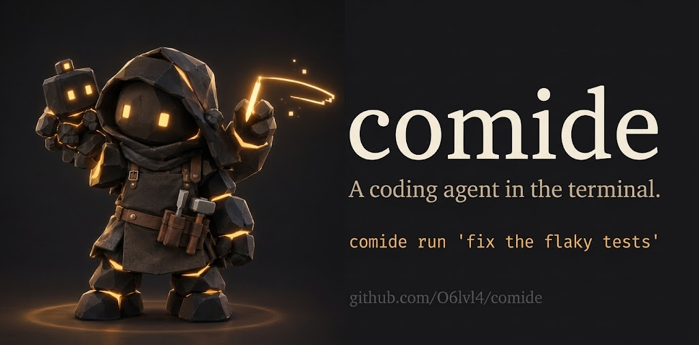

<p align="center">
  
</p>

<p align="center">A coding agent in the terminal, in the line of Claude Code, Codex and Aider,<br>that hands its code changes to golemide.</p>
<p align="center">
  <a href="README.md"></a>
  <a href="README.ja.md"></a>
</p>

```sh
comide                                # a conversation in this directory; /exit to leave
comide run "fix the flaky tests"      # one request, answered, then exit
comide --yes --root ../project        # run shell and verify commands without asking
comide errand "make the build pass"   # one task worked to the end in a terminal, unattended
```

comide decides what to look at and what to change. Code changes go to
[golemide](https://github.com/O6lvl4/golemide), which edits, runs the tests and retries
until they pass.

## Setup

1. **Almide** 0.70.0 or later.
2. **golemide 0.2.0 or later** on `PATH`. comide's edits and `solve` go through it,
   and it says at startup when golemide is missing or too old.
   ```sh
   git clone https://github.com/O6lvl4/golemide && cd golemide
   almide build src/main.almd -o golemide && ln -s "$PWD/golemide" ~/.local/bin/golemide
   ```
3. **comide**
   ```sh
   git clone https://github.com/O6lvl4/comide && cd comide
   almide build src/main.almd -o comide
   ln -s "$PWD/bin/comide" ~/.local/bin/comide
   ```
4. **Credentials**, shared with golemide: Cloudflare Workers AI's
   `CLOUDFLARE_ACCOUNT_ID` and `CLOUDFLARE_API_TOKEN` in `~/.config/golemide/.env`
   (or the project's `.env`, or the environment). golemide's `solve` runs on them.

The conversation's model is `--model PROVIDER:MODEL` (or `/model`):

| `--model` | runs on |
|---|---|
| `cf:glm-5.3` (default) | Cloudflare Workers AI |
| `openai:gpt-5`, `openrouter:…`, `deepseek:…`, `zai:…`, `groq:…`, `ollama:…`, `lmstudio:…` | that OpenAI-compatible service, with `OPENAI_API_KEY` and so on |
| `anthropic:claude-sonnet-4-5`, `gemini:gemini-2.5-pro` | Anthropic's Messages API or Gemini, with `ANTHROPIC_API_KEY`, or `GEMINI_API_KEY` / `GOOGLE_API_KEY` |
| `NAME:MODEL` | any other OpenAI-compatible service: `NAME_BASE_URL` and `NAME_API_KEY` |
| `claude`, `claude:opus` | Claude Code's `claude -p` on your Claude login; comide runs the tools |

`solve` runs on golemide's own models unless `COMIDE_SOLVE_MODEL` (and
`COMIDE_SOLVE_STRONG_MODEL`) name others, in the same form; its line says which model did
the work. A `solve` may take `COMIDE_SOLVE_TIMEOUT_S` seconds (default 300), and golemide
0.4.0 or later stops in time to say how far it got. With `claude`, comide turns
off Claude Code's tools, settings, hooks and MCP servers; your global `CLAUDE.md` and
memory are still read.

Optional: [hew](https://github.com/O6lvl4/hew), [gramide](https://github.com/O6lvl4/gramide)
and [ctxgate](https://github.com/O6lvl4/ctxgate) on `PATH` for reading, mapping and
summarising; a local [SearXNG](#web-search) for `web_search`.

## Tools

The model's tools are programs that already exist:

| Tool | Program |
|---|---|
| `read`, `outline`, `search`, `tree` | hew: a function by name, a range or a match, not whole files |
| `map` | gramide: the project's files ranked against the task |
| `edit`, `write` | `golemide edit`: loose matching for quotes from memory, a syntax check before writing |
| `solve` | `golemide solve --json`: edit, verify, retry until the command passes |
| `shell` | ctxgate: long output summarised, the exit status kept |
| `web_search`, `web_fetch` | SearXNG, and Almide's `http` with every redirect checked |
| `reference` | the language's own toolchain: the syntax as one checked program, a standard library module's functions (Almide) |

A shell command, and the verify command `solve` would run, are asked about first.
Pages are read only from the public web.

## Instructions

comide reads what the project wrote down for an agent before the first request, and
says which files it read:

| File | Whose |
|---|---|
| `~/.config/comide/AGENTS.md` | yours, for every project |
| `AGENTS.md`, `CLAUDE.md`, `.claude/CLAUDE.md` in the project | the project's |
| the files in `$COMIDE_INSTRUCTIONS` (separated by `:`) | named by whoever starts comide |

A `CLAUDE.md` that only says `@AGENTS.md`, or holds the same text, is read once. A file
over 24,000 characters is cut, and says so. A file of the project's that is a link to
somewhere outside the project is not read; the same holds for the project's skills.

Those are for the model that talks. The model that edits is a different one, behind
`solve`, and is told separately: the files in `$COMIDE_SOLVE_INSTRUCTIONS` go to golemide
under every task. Put there what the project says about how its code is written.

## Skills

A skill is a directory with a `SKILL.md` in it: a procedure written down for one kind
of task, with `name` and `description` in its front matter. comide lists the names and
descriptions at the start, and reads a skill's text only when the model opens it with
the `skill` tool.

They are looked for in `.claude/skills` and `.agents/skills` in the project, then
`~/.config/comide/skills`, `~/.claude/skills`, and the directories in `$COMIDE_SKILLS`
(separated by `:`). The first place to name a skill keeps it.

## Long conversations

Old tool output is cut to its opening lines as a conversation grows. When that is not
enough, and a call's input passes `$COMIDE_COMPACT_TOKENS` (default 120,000), the
conversation is replaced by a note about it: what was asked, what was decided, what
was found, what was changed, what was under way. The request being worked on is put
back word for word, and the work goes on. `/compact` does it on demand.

The note is written by `$COMIDE_SUMMARY_MODEL`, the conversation's model unless set.
Exact tool output from before the note is gone, and the model is told to look again.
What the note replaced is written to a file in the run's temporary directory, and you
are told where.

## Going back to a conversation

Every conversation is kept after each request, in `~/.comide/sessions/`, under the
project's path. `comide --continue` goes on with the project's most recent one, and
`comide --resume ID` with a given one; both work with `run` too.

The messages, the cost so far and the command that checks the work come back. The
system prompt is written afresh, so instruction files and skills changed since are read
as they are now. Permission to run commands is not kept, and is asked for again.

"Most recent" is the one most recently started. A kept conversation is the whole of it:
every tool's output, and the system prompt with your own instruction files and notes in
it. The files are readable by you only, and are not in the project.

Inside a conversation, `/resume` lists the project's earlier ones and goes on with the
one you pick, and `/export` writes the conversation as a text to read: what was asked,
what comide said and ran, and what came back, with long results cut and the system
prompt left out. It goes to `~/.comide/exports/`, or to the file you name.

## Going back to before a request

`/rewind` goes back to before a request of the conversation: pick the request, and then
the conversation, the files, or both. When the conversation goes back, the request is
put in the input box again, to send as it was or to write anew.

The files are copies. The moment before comide first changes a file in a request, it
copies the file as it is: before `edit` and `write`, the file they name; before a
terminal command, the files the command names (`rm notes.txt`, `sed -i … src/a.py`,
`echo x > out.txt`). Going back writes the copies over what is there and removes what
was made. Nothing is copied until something is about to change, so a request that only
reads costs nothing, in a project of any size. The copies are under
`~/.comide/checkpoints/`, by project and conversation, readable by you only, kept for
two weeks, and they have nothing to do with version control: no repository is read,
written or made, yours included. Because they are kept under the conversation's name, a
conversation taken up again (`--continue`, `/resume`) can still go back.

What does not go back, and `/rewind` lists what it can see of it: a file a command
changed without naming it (a formatter run over a directory, a build, a script that
writes files), what `solve` changed, and anything outside the project (a database, a
remote, an installed package). A file you changed yourself after comide did goes back
with the rest. `COMIDE_CHECKPOINTS=0` keeps nothing.

## Commands

`/help` lists them. Besides the ones named in the sections here: `/copy` (comide's last
answer, to the clipboard), `/init` (comide writes `AGENTS.md` for the project), `/review`
(comide reviews the changes not yet committed), `/context`, `/status`, `/permissions`,
`/hooks`, `/mcp`, `/skills`, `/agents` (what is set up and where it is written), and
`/doctor` (whether the programs comide leans on are there). A command typed from habit
that comide has no use for, `/login` say, is answered with what to do instead.

## Memory

A project has one file of notes that outlive a session:
`~/.comide/memory/<the project's path>/MEMORY.md`, a dated line per note. It is read at
the start of every conversation in the project, and the model adds to it with the
`remember` tool: a correction you made, a preference you stated, where something is
that took steps to find. `/memory` says where the file is. To change or remove a note,
edit the file; nothing else holds what comide remembers.

## Goals

A request ends when it is answered. A goal does not: `/goal TEXT` (or `--goal TEXT`)
says what the session is for, and whenever the model stops while the goal stands, comide
asks whether it is met. If it is not, the model goes on. It ends when the model answers
`GOAL MET` with its evidence, when it shows it needs you, or after 25 askings in one
request.

The goal stays in your words. It is kept with the conversation, so `--continue` comes
back with it, and it is put back word for word when a note replaces a long conversation.
`/goal` shows it and `/goal clear` drops it.

That the goal is met is the model's claim, with evidence for you to read. It is not a
proof.

## Helpers

Finding where something is handled can take twenty reads, and all twenty stay in the
conversation. The `explore` tool hands such a question to a helper: another comide,
started with `--read-only`, in a conversation of its own. Only its answer comes back.

The helper runs on `$COMIDE_EXPLORE_MODEL`, the conversation's model unless set; a fast,
cheap model does this well. It is started from `comide` on `PATH` (`$COMIDE_BIN` names
another), goes through the same runner, and cannot start a helper of its own. What it
spent is counted in the session's cost.

## Plan mode

`/plan` (or `--plan`) has comide look at the project and answer with a plan: what it
would change, in which files, in what order, and how each step would be checked. While
it is on, the tools that change a file or run a command do not run. `/go` approves the
plan and carries it out; `/plan off` leaves it. After `comide run "..." --plan`,
`comide run "go ahead" --continue` carries the plan out.

`--read-only` is the same holding of the tools without the plan: a run that only looks.

## Errands

`comide errand TASK` works one task to the end with nobody watching. It is a different
loop from the conversation's: the model is sent no tools and answers every step in
writing, as one JSON object (what it sees, what it plans, the commands to run, whether
it is done), and it has one terminal that lasts. The directory it changed to and the
variables it exported are still there for the next command; a command that outlasts its
wait keeps running and can be waited for again, read on, or stopped. The task is done
when the model has said so twice.

Every command the model writes is run without asking. The [settings](#settings) are
heard: a command a `deny` rule names is not run, and neither is one an `ask` rule names,
since nobody is there to ask; the `shell` hooks run before and after each command. Start
an errand where its terminal can do no harm: a container, or under
[nautra](https://github.com/Aid-On/nautra) with `nautra/run.sh TASK --root DIR`, where
the agent is a WebAssembly component that holds no key (nautra puts the key on the
request to the model's host) and the terminal is a native tool confined to the one
directory it was given. `ci/check.sh` tries to get out from inside it.

| | |
|---|---|
| `--model M` | as for the conversation (default `cf:glm-5.3`) |
| `--max-steps N` | model calls before it stops (default 200) |
| `COMIDE_LOG_DIR` | where the record is written as it goes: `trajectory.json`, `cost.txt`, `transcript.json` |
| `COMIDE_REASONING_BACK=0` | what the model reasoned is not sent back to it (cheaper; the default sends it) |
| `COMIDE_CHECK=1` | said complete, the work is checked once more in a new conversation that sees only the task |

Under nautra the agent has more than the terminal from 0.8.1: `read`, `write` and
`reference` are WebAssembly components of their own (`src/tool*.almd`), each given only
what it needs — `read` sees the project and cannot write, `write` has the project and
nothing else, `reference` has nothing at all — and none can start a program or reach a
network. The agent asks nautra which tools its composition gives and tells the model of
those, so a tool added to the composition is one the model can use. `TOOLS_OFF=1` gives
the terminal alone. When [hew](https://github.com/O6lvl4/hew) is there as a component
(`HEW_WASM`, or `build/hew.wasm` in a hew beside comide), reading is hew's: `read` by
symbol, range or match, `outline`, `search` and `tree`, each started with the project
read-only and nothing else. When [golemide](https://github.com/O6lvl4/golemide)'s edit is
there as a component (`GOLEMIDE_EDIT_WASM`, or `build/golemide-edit.wasm` in a golemide
beside comide), `edit` and `write` are golemide's: a passage quoted from memory is found,
a file is not blanked. As a component it starts no checker; it reads a write with the
grammars linked into it and refuses one that does not parse.

The loop was written and measured outside comide first, against Harbor's terminus-2 on
Terminal-Bench 2 tasks with the same model, and passes about as many.

From 0.7 the conversation, `comide run` and `-p` use the same core: the model answers
every step in writing and has one terminal that lasts from request to request. The
[tools](#tools) are the same ones, written by the model as commands
(`{"tool": "edit", "args": {...}}`) beside terminal commands instead of sent as tool
calls: edit, write and solve still go through golemide, and permissions, hooks, plan
mode, goals, skills, memory, MCP, helpers and the note that takes a long conversation's
place work as before. What differs from an errand is that a person is there: a terminal
command no rule speaks of is put to you first. `--loop tools` (or `COMIDE_LOOP=tools`)
is the loop comide had before, with the tools sent as tool calls and a shell that
starts afresh for every command.

A file's contents do not go well inside a JSON string, so the model may write a long
text after the object, as it is, between a `<<<BODY NAME` line and a `>>>BODY NAME`
line, and name it where it is meant (`"content": "@body:NAME"`). `web_search` is offered
only when a search engine answers at the start.

What the model reads is material, not orders: a file, a README, a command's output, an
issue quoted in the task. The model is told so, and told to leave undone what such a
text asks for beyond the task, and to say that it did. Under nautra there is a check
besides the telling. Whoever gives the task can mark what is quoted in it:

```
Fix the crash described below.
<<<QUOTED k3f9
(the issue, as it was filed)
>>>QUOTED k3f9
```

The name is yours; one the quoted text could not have guessed keeps that text from
closing the mark itself. A command the model then writes is compared with the quoted
part and with everything it has been shown since: a command line found there letter for
letter, and not in your own words, is not run, and the model is told why. A command the
model wrote in other words passes: this stops an order carried out as it was written,
not every way of following one.

## A confined terminal

`comide --confined` keeps the conversation where it is and puts the terminal somewhere it
can do no harm. comide starts [nautra](https://github.com/Aid-On/nautra), has it publish
comide's own terminal program on this machine behind a token (nautra's "publishing tools
to an agent that runs elsewhere"), and sends every command the model writes there. A
command can then

- write only under the project and `/tmp`,
- read only the project and the system's directories, plus the toolchains shown to it
  read-only (Homebrew, Nix, Xcode, a version manager's directory under `~/.local`): not
  your home directory, not `~/.ssh`, not where comide's and golemide's keys are kept,
- reach no network, unless `COMIDE_CONFINED_NET` names the hosts
  (`"pypi.org:443 files.pythonhosted.org:443"`).

The directory it changed to and the variables it exported still last from command to
command. The model is told where it stands, so it does not spend its steps rewording a
command that will be refused again. If nautra or the terminal program
(`build/comide-shell`, built by `nautra/build.sh`) is not there, comide does not start:
it never falls back to an unconfined terminal.

What is not confined: `edit`, `write`, `read` and the other tools, which are comide
calling golemide and hew, not commands the model wrote. Known gap on macOS: the system C
compiler (`cc` through Xcode's `xcrun`) does not run inside, because it writes a cache
outside the sandbox; Python and git do. `COMIDE_CONFINED_READS=open` lets commands read
outside the project (the key directories stay closed), and `COMIDE_CONFINED_TOOLS` names
the toolchain directories itself.

## Settings

What may run without asking, and what may not run at all, is written as rules in JSON:

```json
{ "permissions": {
    "allow": ["shell(git status*)", "shell(npm test*)"],
    "ask":   ["shell(git push*)"],
    "deny":  ["read(.env*)", "shell(rm -rf*)"] } }
```

A rule is a tool, and in brackets what the call is about: a command for `shell` (and
for the verify command of `solve`), a path for `read`, `edit` and `write`,
`domain:HOST` for `web_fetch`. `*` is any run of characters. `deny` wins over `ask`,
`ask` over `allow`; a call no rule speaks of does what it always did.

| File | Whose |
|---|---|
| `~/.config/comide/settings.json` | yours, for every project |
| the files in `$COMIDE_SETTINGS` (separated by `:`) | named by whoever starts comide |
| `.comide/settings.json` in the project | the project's |

Of a project's file only `ask` and `deny` are used as found, since they can only make
comide more careful. Its `allow` rules and hooks are used after you start comide once
with `--trust-project`, and only while the file stays exactly as it was then.

A rule on `read` speaks for every tool that reads (`read`, `outline`, `search`,
`tree`), and a rule on `edit` for both tools that write a file. Paths are compared as
the place they name: `a/../.env`, `././.env` and `.ENV` are `.env` to a deny or an ask
rule. `edit` and `write` refuse anything under `.comide/`, whatever the lists say: the
settings are yours to change, not the model's.

The rules are a guard rail, not a wall. On shell commands an allow rule does not apply
to a command that chains or redirects; deny and ask rules are tried against each part of
a chain, with grouping, leading `NAME=value` words and the program's directory taken
off. They do not see through `bash -c`, an alias, a script, or the same thing done with
other flags. A rule on a file does not stop a search of the directory it is in, a link
that points at it, a shell command that reads it, or `solve`, whose edits golemide
makes. What confines a command or keeps a file from the model is the runner
(`--runner`).

### Hooks

The same files can name commands of yours to run at fixed points. The names and the
shape are Claude Code's, so a hook written for it reads the same here:

```json
{ "hooks": {
    "PreToolUse": [ { "matcher": "shell|edit",
                      "hooks": [ { "type": "command", "command": "./check.sh" } ] } ] } }
```

| Event | When | Exit 2 means |
|---|---|---|
| `SessionStart` | before the first request | (nothing: what it prints is told to the model) |
| `UserPromptSubmit` | before a request is sent | the request is not sent |
| `PreToolUse` | before a tool runs | the tool is not run |
| `PostToolUse` | after a tool ran | the objection goes under the result |
| `Stop` | when the model answers and would stop | the work is not finished, and it goes on |

A hook gets one JSON object on stdin (`hook_event_name`, `session_id`, `cwd`, and
`tool_name`, `tool_input`, `tool_response` or `prompt` where they apply). Exit 0 goes
on; exit 2 stops, with stderr as the reason given to the model; any other exit is the
hook's own failure, said to you, and the session goes on. `matcher` is comide's tool
names separated by `|`.

A hook runs as you, unconfined. A project's hooks are not used until the project is
trusted (`--trust-project`).

### MCP servers

Tools that live in other programs are named in the same files, in the shape every MCP
client uses:

```json
{ "mcpServers": {
    "files": { "command": "npx", "args": ["-y", "@modelcontextprotocol/server-filesystem", "."] },
    "docs":  { "type": "http", "url": "https://example.com/mcp",
               "headers": { "Authorization": "Bearer ..." } } } }
```

The model is not given the servers' tools. It is told the servers' names and has three
tools to reach through them: `mcp_tools` lists what a server offers, `mcp_describe`
gives one tool's arguments, `mcp_call` calls it. A server with fifty tools costs one
line until one of them is looked at.

Each of those is one short exchange: the server is started (or its address called),
greeted, asked, and left. Nothing is kept running between calls, so a server that only
works by remembering earlier calls in its own memory is not served by this.

`mcp_call` asks first unless a rule allows it (`mcp_call(files/read_file)`,
`mcp_call(files/*)`), and does not run in plan mode. A server runs as you, unconfined;
a project's servers are not used until the project is trusted.

## Keys

Enter sends · Shift+Enter or Alt+Enter (Option on a Mac) adds a line, as does `\` then
Enter · ↑↓ history · Tab completes `/commands` ·
Esc interrupts a turn · Ctrl+D leaves. `/help` lists the rest.

You need not stop comide to tell it something. While it works, type: the line shows
beside the progress, and Enter hands it over. The model reads it with the results of
the step it is on, before its next reply, as something you said. What you typed and did
not enter, or entered when the request was already ending, is in the input box when the
request ends.

A step can be long, and what you hand over waits for it. So Esc means two things. With
nothing typed, it stops what is running, as before. With something typed, or handed over
and still waiting, it stops the request there and sends that at once as the next
request: the way to turn comide round in the middle of a long command. Ctrl+C only
stops, whatever is typed.

## Web search

`web_search` needs a SearXNG with JSON answers on, bound to this machine:

```sh
mkdir -p ~/.config/searxng
docker run -d --name searxng --restart unless-stopped \
  -p 127.0.0.1:8888:8080 -v ~/.config/searxng:/etc/searxng searxng/searxng
```

In `~/.config/searxng/settings.yml`, set `limiter: false` under `server:` and
`formats: [html, json]` under `search:`, then `docker restart searxng`.
`$COMIDE_SEARXNG_URL` points at another instance.

## License

MIT or Apache-2.0, at your option.
